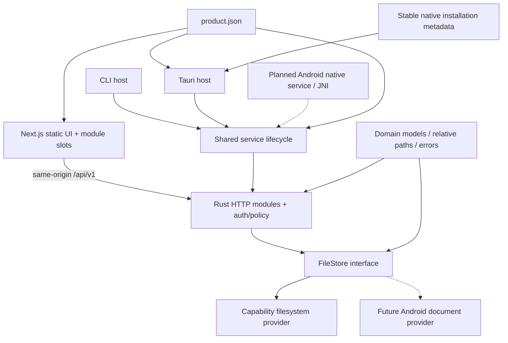

# Architecture

The runtime is an independently implemented Rust file service. Next.js exports static browser assets; Tauri owns native window/service lifecycle. Node builds the UI and Python supports configuration/packaging/verification; neither is a delivered file-server runtime or request handler.

## Modules

`share-domain` contains portable path validation, entry/error/permission/product models. Windows reserved device stems, including superscript COM/LPT names, are rejected in each relative component without banning ordinary Unicode. `share-storage` exposes a trait and a real filesystem implementation with capability-relative I/O and staged publication. `share-http` registers feature routes, authentication, policy and lifecycle without bypassing storage. `share-cli` configures and runs the shared service. The desktop application is a separate build composition consuming the same Rust library.

The feature registry contains `files` (listing/download), `uploads` (streamed creation) and `manage` (directory/mutation operations). Uploads/manage require files. Configuration dependency errors are explicit. Disabled modules have no mounted routes; reported permissions are the intersection of module availability and server policy.

Web modules register view/toolbar/panel contributions. Shared application context supplies the current path, selected entry, permissions, refresh callback and API client. A file browser renders contributions through slots so an upload module can be removed without editing its private view.

The current web registry also supports module providers, allowing uploads and management to own their panel state. An optional `SelectionPanel` contribution sits immediately after the inspector; ordinary panels follow, so transfer history does not separate actions from the selected entry. Toolbar order stays independent of that placement. All file operations use the typed `FileApi`; XHR transfers retain `File` references and stream browser bodies without constructing whole-file JavaScript buffers. The upload queue is sequential and distinguishes sent bytes, finalization and confirmed publication. Requested-folder state must not expose actionable rows from a previous successful listing after navigation fails.

The shell owns selection focus through the shared callback contract. Explicit inspector clearing restores the file/folder selection origin, with a stable current-folder fallback when it is disconnected. Passive refresh and management selection clearing do not perform that selection handoff. Explicit task cancellation/completion separately captures operation-owned focus before controls disable or disappear, preserves any unrelated focus deliberately chosen while waiting, and uses surviving openers, retained failure controls or the generic `ModuleRuntime.focusCurrentFolder()` destination. History clearing uses its own surviving heading. Module composition does not require feature-specific DOM queries or overload selection origins.

## Contracts and lifecycle

The API uses `/api/v1` and stable JSON models documented in `contracts/api-v1.md`. Static assets and API share an origin. Browser downloads use HttpOnly session cookies; data uploads use streams rather than whole-file conversion.

A host builds a service configuration, binds a listener and gets a handle containing the actual address and controlled shutdown. Native window disposal does not define Android server survival; Android must own the service through a platform adapter. Static UI deployment paths are separate from shared data paths.

`ServerConfig::new`, `start` and `RunningServer::{address,request_stop,stop}` form the shared lifecycle. `start_with_store`/`router_with_store` support a replaceable provider without opening `config.root`. Whole-request cancellation and tracked drain cover body extraction and storage futures; explicit stop reports a missed two-second drain deadline.

Downloads use a 128 KiB default read buffer. `DownloadControl` holds one validated shared setting, accepting 16–128 KiB in 16 KiB increments; handlers snapshot it once at request entry, so an adjustment affects subsequent requests. It adds no per-block counters, background sampling or HTTP configuration endpoint. Hosts obtain the application-side handle from `RunningServer::download_control()`.

`OpenFile` retains a `FileReader` backed by either the original seek-capable handle or an asynchronous read-only stream. Range positioning uses that object instead of reopening a pathname. The filesystem path seeks directly to the requested offset and checks a missing prefix; stream-only providers keep a bounded forward-read fallback. Metadata and content therefore retain the same opened-file identity while high-offset filesystem ranges avoid discarding every preceding byte.

The filesystem provider uses no-follow directory capabilities, exclusive native rename on Linux/Apple-family targets and exclusive hard-link publication of internal stages on Windows. Windows user moves are unsupported. Empty reserved `INOUTTMP` containers persist across operations; guards remove unpublished files and register active object identities to reject aliases. Nonrecursive user-folder deletion accounts for an empty internal container and closes its inspected child capability before removing the folder through its parent. Windows directory capabilities deliberately deny delete sharing; this lifetime correction preserves the existing containment and nonempty-directory checks.

Static assets come through `FileStore::web_assets`, whose default is unsupported. `FsStore` proves separation against its actual root, rejects overlap/symlink/hard-link aliases, and returns bounded byte snapshots. HTTP serves the snapshot map instead of an ambient live directory. Limits are 128 MiB/10,000 asset files/depth 128 and 100,000 shared entries scanned; startup is synchronous and fails closed when isolation cannot be proved.

Tauri exposes local-main-window commands for status, native folder selection, start, stop, manager open, key generation and six diagnostic controls. A separate `files` webview loads the service's loopback URL, receives no native command capabilities, and cannot navigate off that exact service origin or create popup windows. The Next entry chooses host controls only at internal Tauri/development origins; injected Tauri IPC alone never switches a loopback file-manager page to native controls. Manager close stops sharing; app quit owns shutdown independently of a pending folder picker.

Native status includes nullable sanitized `activeSettings`: actual network binding, listener port, upload/management permissions and whether authentication is configured. The host sets them only after successful start and clears them before stop. Running UI controls use that status after reload; stopped controls use local setup drafts. Status and browser storage never recover the access key. The exact additive contract is in [API v1](../contracts/api-v1.md).

Native diagnostics are disabled by default and lazily loaded after five app-name activations within five seconds. A Rust-owned module validates temporary settings and one read-only loopback HEAD/range probe, retaining any configured access key privately. A single application-wide permit prevents overlapping tests across service restarts. The probe owns its Hyper connection/request futures, reads at most 64 MiB with at most eight connections, and cancels on explicit Cancel, mode disable, Stop, exit or caller drop; its deadline is 30 seconds. Host lifecycle locks are released before network work. The panel guards initialization, settings/probe replies, errors and finalizers with session/action ownership. Stop/restart releases old flags; an obsolete completion cannot restore a sample or clear a newer action's busy state. Closing the panel restores defaults and returns focus to its opener. There is no telemetry or diagnostic file output; inactive diagnostics do no sampling.

The page owns a single initial-readiness state, separate from sharing being active. `FileManager` reports its first usable context, authentication screen or connection error; `NativeHost` reports its first status or recoverable IPC error, including stopped/no-folder setup. Their optional callbacks do not alter feature state or restart startup during navigation, retry or Start/Stop. Startup owns only its presentation, an Escape listener while waiting and bounded exit cleanup. Removal uses computed screen/wordmark CSS transition durations and delays, capped at one second, with immediate initial/live reduced-motion cleanup. Ready controls and error recovery are usable independently of visual completion. No animation loop participates in service startup or file transfers.

Packaged assets map to `resource_dir/web`. Release builds never search the working directory or repository; a checked repository fallback exists only in debug. Next exports the same static app consumed by the service and native host; CI reuses the tested export between ordered desktop targets.

## Branding and identity

Branding is read from the six-field `product.json`. Native installation metadata is read separately from `config/native-identity.json`, with a matching application ID, stable `product_name` and explicit `wix_upgrade_code`. Synchronization validates both before writing generated frontend/desktop/distribution metadata. Tauri `productName` comes from stable installation metadata; the main-window title comes from mutable display branding. This preserves Debian package/resource and NSIS installation/registry identity across a display rename and pins the optional MSI upgrade UUID. OS installation labels remain stable until an explicit migration. Package names such as `share-domain` and the HTTP Product contract remain unchanged.

The display name is **inout**, with `inout-next` retained as the repository/distribution slug. A memoized product-aware wordmark supplies the header, footer and startup with local SVG glyphs and a legible text fallback. The native header's optional activation callback remains separate from this presentation; a wordmark in the HTTP manager grants no native command capability.

The packaging identity probe copies an existing native executable into temporary target folders, generates baseline/renamed fixture configurations and runs Tauri `bundle`. It compares actual Debian control/resource fields or emitted NSIS template identity while leaving primary outputs and the web export intact. Config/title and emitted-package checks do not establish native runtime rebranding or an installed upgrade.

## Store and platform adapters

The [dated distribution requirements](distribution/store-readiness.md) constrain platform/build compositions rather than the domain/API. Store identity, explicit platform build numbers, signing roles, permissions, privacy material and compiled feature selection remain separate from mutable display branding. No proprietary store SDK is a core dependency, and store baselines bundle the static Next export rather than downloading code that changes native features.

Android needs a native Service owning the Rust lifecycle independently of Activity/WebView, with actual foreground-service type/prerequisites, user visibility/Stop and timeout cleanup. SAF/document grants belong in a provider adapter; they do not become unrestricted filesystem paths, and provider publication/move capabilities must reflect their real guarantees. SDK-aware local-network permission checks belong in that native adapter.

iOS uses foreground/allowed finite task lifetime and security-scoped document grants; it cannot inherit the Android background-service promise. A Mac App Store composition separately adds sandboxed selected-folder/bookmark access, appropriate network entitlements, signed resources and `.app`/`.pkg` packaging. Current desktop close-to-stop behavior does not implement either mobile lifecycle or persistent sandbox grants.

The F-Droid recipe must build web/Rust/Android outputs from one public source/lock set in a clean environment and record accepted build-tool origins. Reproducibility and signing-channel continuity require actual APK evidence. The [privacy data inventory](distribution/privacy-data-inventory.md) records the current application's data paths; future native permissions, SDKs, transport/pairing and logging update it before release. These adapters/packaging/privacy implementations remain future work.

## Current status

The Rust, CLI, web and desktop compositions are implemented and exercised by real service/browser tests and Linux/Windows/macOS target CI. Windows native picker, manager, supported writable operations and shutdown have bounded runtime validation; installation/offline/device/signing remain separate. Built UI patterns are in [DESIGN.md](../DESIGN.md), delivery costs in [package size and runtime](distribution/size-and-runtime.md), and support boundaries in [platforms](platforms.md). Seek-aware ranges and configurable bounded download buffers are implemented. A storage blocking executor, durable transfer recovery and native/store adapters remain extensions. Dynamic executable plugins are excluded from store baselines.

Future [network-address recommendations and QR presentation](network-selection.md) sit beside host lifecycle through platform network snapshots/events and a separate selector. Recent connections are one signal alongside explicit choice, confirmed hotspot state and verified successful use. Recommendations use the actual port and change displayed URLs without migrating a live listener. The current host only enumerates IPv4 LAN addresses; platform classifiers, change subscriptions, feedback and QR rendering require their own implementation and device validation.
