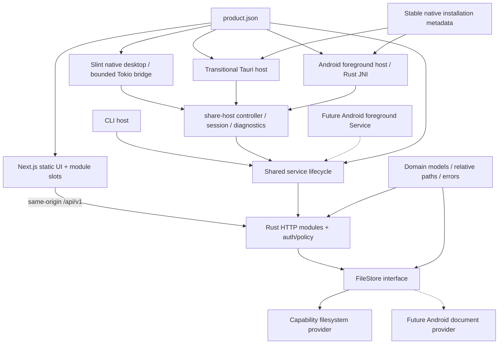

# Architecture

The runtime is an independently implemented Rust file service. Next.js exports static HTTP/browser assets. Renderer-free `share-host` supplies the application controller, diagnostics and session. The opt-in Slint desktop trial renders without WebView; existing Tauri desktop/Android compositions remain transitional. Node builds the web UI and Python supports configuration/packaging/verification; neither is a delivered file-server runtime or request handler.

## Modules

`share-domain` contains portable path validation, entry/error/permission/product models. Windows reserved device stems, including superscript COM/LPT names, are rejected in each relative component without banning ordinary Unicode. `share-storage` exposes a trait and a real filesystem implementation with capability-relative I/O and staged publication. `share-http` registers feature routes, authentication, policy and lifecycle without bypassing storage. `share-cli` configures and runs the shared service. The desktop application is a separate build composition consuming the same Rust library.

The feature registry contains `files` (listing/download), `uploads` (streamed creation) and `manage` (directory/mutation operations). Uploads/manage require files. Configuration dependency errors are explicit. Disabled modules have no mounted routes; reported permissions are the intersection of module availability and server policy.

Web modules register view/toolbar/panel contributions. Shared application context supplies the current path, selected entry, permissions, refresh callback and API client. A file browser renders contributions through slots so an upload module can be removed without editing its private view.

The current web registry also supports module providers, allowing uploads and management to own their panel state. An optional `SelectionPanel` contribution sits immediately after the inspector; ordinary panels follow, so transfer history does not separate actions from the selected entry. Toolbar order stays independent of that placement. All file operations use the typed `FileApi`; XHR transfers retain `File` references and stream browser bodies without constructing whole-file JavaScript buffers. The upload queue is sequential and distinguishes sent bytes, finalization and confirmed publication. Requested-folder state must not expose actionable rows from a previous successful listing after navigation fails.

The shell owns selection focus through the shared callback contract. Explicit inspector clearing restores the file/folder selection origin, with a stable current-folder fallback when it is disconnected. Passive refresh and management selection clearing do not perform that selection handoff. Explicit task cancellation/completion separately captures operation-owned focus before controls disable or disappear, preserves any unrelated focus deliberately chosen while waiting, and uses surviving openers, retained failure controls or the generic `ModuleRuntime.focusCurrentFolder()` destination. History clearing uses its own surviving heading. Module composition does not require feature-specific DOM queries or overload selection origins.

## Contracts and lifecycle

The [native GUI evaluation](native-gui.md) follows Slint first, with egui as the fallback; toolkit adoption remains undecided. `HostController`, capabilities, resource discovery and diagnostics now live in `share-host`, with Tauri public reexports preserving existing composition. `HostSession` owns sanitized snapshots, Stop/close confirmation, bounded cleanup and current-run receipts. Neither layer depends on Tauri or Slint. Pickers, grants, native lifecycle, branding and signing remain separate adapters.

The independent Slint workspace selects winit/FemtoVG/accessibility with defaults disabled. Its UI event loop owns widgets; a two-worker Tokio runtime owns session/network work behind a16-command queue. Admission/finalization notifications wake an idle bridge; per-block byte counts remain atomic-only. Active/dirty progress is sampled at250ms and delivered through one coalesced state slot. FIFO command IDs and a completion watermark travel with every snapshot, so an older sample cannot unlock a pending action and a later passive sample cannot erase its acknowledgement. Locale/theme updates reuse the same session and transfer model. Confirmed interruption owns shutdown; cancellation leaves the listener and admitted bodies intact. Stopped receipts reset only at the next successful Start.

The API uses `/api/v1` and stable JSON models documented in `contracts/api-v1.md`. Static assets and API share an origin. Browser downloads use HttpOnly session cookies; data uploads use streams rather than whole-file conversion.

A host builds a service configuration, binds a listener and gets a handle containing the actual address and controlled shutdown. Android's first adapter deliberately shares only while its Activity is foregrounded. A future background-capable composition needs independent native Service ownership. Static UI deployment paths are separate from shared data paths.

`ServerConfig::new`, `start` and `RunningServer::{address,request_stop,stop}` form the shared lifecycle. `start_with_store`/`router_with_store` support a replaceable provider without opening `config.root`. Whole-request cancellation and tracked drain cover body extraction and storage futures; explicit stop reports a missed two-second drain deadline.

`PolicyControl` publishes immutable permission/authentication snapshots atomically. `PolicyUpdate` supplies the expected revision, six action flags and `KeyUpdate::{Keep,Replace,Remove}`. Stale/invalid changes preserve the whole current snapshot; mounted-module availability cannot be expanded by a permission edit. Explicit public upload/general-management/rename is permitted, while deletion requires a configured key and authenticated admission. Permission-only edits retain the same session store; key replacement supplies a new one. Every admitted handler and GET body retains its snapshot independently of later changes. The control is Rust application authority, with no public HTTP settings endpoint.

`RunningServer::transfer_control()` exposes bounded process-local observations. Leases cover pending provider work, uploads/copies and GET response bodies; HEAD creates no transfer. Chunk-level counts and terminal publication/served/interrupted/failed states need no server sampler. At most 1,024 active and 200 terminal records are retained. A watch subscription notifies admission/finalization, independently of per-block progress. Known-size copy receipts report the published logical size; unknown-size copies remain unmeasured. Served means downstream body bytes rather than recipient-side saving. Slint displays current-run receipts; durable history/safe-open, live permission IPC/UI and browser ownership across authentication changes remain pending.

Downloads use a 128 KiB default read buffer. `DownloadControl` holds one validated shared setting, accepting 16–128 KiB in 16 KiB increments; handlers snapshot it once at request entry, so an adjustment affects subsequent requests. Buffer tuning adds no sampler or HTTP configuration endpoint; transfer observations separately count yielded chunks. Hosts obtain the application-side handle from `RunningServer::download_control()`.

`OpenFile` retains a `FileReader` backed by either the original seek-capable handle or an asynchronous read-only stream. Range positioning uses that object instead of reopening a pathname. The filesystem path seeks directly to the requested offset and checks a missing prefix; stream-only providers keep a bounded forward-read fallback. Metadata and content therefore retain the same opened-file identity while high-offset filesystem ranges avoid discarding every preceding byte.

The filesystem provider uses no-follow directory capabilities, exclusive native rename on Linux/Android/Apple-family targets and exclusive hard-link publication of internal stages on Windows. Windows user moves are unsupported. Empty reserved `INOUTTMP` containers persist across operations; guards remove unpublished files and register active object identities to reject aliases. Nonrecursive user-folder deletion accounts for an empty internal container and closes its inspected child capability before removing the folder through its parent. Windows directory capabilities deliberately deny delete sharing; this lifetime correction preserves the existing containment and nonempty-directory checks.

Static assets come through `FileStore::web_assets`, whose default is unsupported. `FsStore` proves separation against its actual root, rejects overlap/symlink/hard-link aliases, and returns bounded byte snapshots. HTTP serves the snapshot map instead of an ambient live directory. Limits are 128 MiB/10,000 asset files/depth 128 and 100,000 shared entries scanned; startup is synchronous and fails closed when isolation cannot be proved.

Tauri exposes local-main-window commands for status, native folder selection, start, stop, manager open, key generation and six diagnostic controls. Desktop's separate `files` webview loads the loopback service without native capabilities and cannot navigate off that exact origin or create popup windows. Android advertises and enforces unavailable folder/manager commands. The Next entry chooses host controls only at internal Tauri/development origins; injected Tauri IPC alone never switches an HTTP file-manager page to native controls. Desktop manager close stops sharing; app quit owns shutdown independently of a pending folder picker.

Native status includes nullable sanitized `activeSettings`: actual network binding, listener port, upload/management permissions and whether authentication is configured. `capabilities` separately describes folder versus app-private storage, folder/manager availability and foreground-only lifetime. The host sets effective settings only after successful start and clears them before stop. Running UI controls use that status after reload; stopped controls use local setup drafts. Status and browser storage never recover the access key. The exact additive contract is in [API v1](../contracts/api-v1.md).

Android composes `files/shared` as the fixed private share, beside `files/runtime-assets/web`. `MainActivity` materializes original APK web bytes before Rust starts, reading a bounded, sorted SHA-256 index through `InputStream`. It verifies every source/destination, stages a complete replacement and repairs tampered caches without touching shared files. The index is outside the public web tree. Runtime assets retain the existing128 MiB/10,000-file/depth128 bounds and filesystem snapshot/containment contract; release startup has no repository fallback.

The native Android pause event closes the start gate synchronously within the event handler before scheduling bounded shutdown. A pending-suspension count and transition mutex prevent a queued or in-flight start reopening sharing while backgrounded or draining. Resume only restores eligibility. Root Back backgrounds the single host task like Home; configuration recreation preserves a usable stopped host. True destruction drains/cancels the owned service and terminates the process without C/C++ exit destructors racing active Android renderer threads. The shutdown worker exclusively owns Android's final termination; framework exit requests remain deferred even after service cleanup completes. Desktop retains its normal framework exit after cleanup. A subsequent Android launch initializes a new runtime. This is foreground-only hosting, with no SAF, foreground Service or second manager Activity.

Native diagnostics are disabled by default and lazily loaded after five app-name activations within five seconds. A Rust-owned module validates temporary settings and one read-only loopback HEAD/range probe, retaining any configured access key privately. A single application-wide permit prevents overlapping tests across service restarts. The probe owns its Hyper connection/request futures, reads at most 64 MiB with at most eight connections, and cancels on explicit Cancel, mode disable, Stop, exit or caller drop; its deadline is 30 seconds. Host lifecycle locks are released before network work. The panel guards initialization, settings/probe replies, errors and finalizers with session/action ownership. Stop/restart releases old flags; an obsolete completion cannot restore a sample or clear a newer action's busy state. Closing the panel restores defaults and returns focus to its opener. There is no telemetry or diagnostic file output; inactive diagnostics do no sampling.

The page owns a single initial-readiness state, separate from sharing being active. `FileManager` reports its first usable context, authentication screen or connection error; `NativeHost` reports its first status or recoverable IPC error, including stopped/no-folder setup. Their optional callbacks do not alter feature state or restart startup during navigation, retry or Start/Stop. Startup owns only its presentation, an Escape listener while waiting and bounded exit cleanup. Removal uses computed screen/wordmark CSS transition durations and delays, capped at one second, with immediate initial/live reduced-motion cleanup. Ready controls and error recovery are usable independently of visual completion. No animation loop participates in service startup or file transfers.

Desktop packaged assets map to `resource_dir/web`; Android uses its validated private materialization. Release builds never search the working directory or repository; the desktop repository fallback exists only in debug. Next exports the same static app consumed by the service and native host; CI reuses the Linux-tested export between ordered Android and desktop targets.

## Branding and identity

Branding is read from the six-field `product.json`. Native installation metadata is read separately from `config/native-identity.json`, with a matching application ID, stable `product_name` and explicit `wix_upgrade_code`. Synchronization validates both before writing generated frontend/desktop/distribution metadata. Tauri `productName` comes from stable installation metadata; the main-window title comes from mutable display branding. This preserves Debian package/resource and NSIS installation/registry identity across a display rename and pins the optional MSI upgrade UUID. OS installation labels remain stable until an explicit migration. Package names such as `share-domain` and the HTTP Product contract remain unchanged.

The display name is **inout**, with `inout-next` retained as the repository/distribution slug. A memoized product-aware wordmark supplies the header, footer and startup with local SVG glyphs and a legible text fallback. The native header's optional activation callback remains separate from this presentation; a wordmark in the HTTP manager grants no native command capability.

The packaging identity probe copies an existing native executable into temporary target folders, generates baseline/renamed fixture configurations and runs Tauri `bundle`. It compares actual Debian control/resource fields or emitted NSIS template identity while leaving primary outputs and the web export intact. Config/title and emitted-package checks do not establish native runtime rebranding or an installed upgrade.

## Store and platform adapters

The [dated distribution requirements](distribution/store-readiness.md) constrain platform/build compositions rather than the domain/API. Store identity, explicit platform build numbers, signing roles, permissions, privacy material and compiled feature selection remain separate from mutable display branding. No proprietary store SDK is a core dependency, and store baselines bundle the static Next export rather than downloading code that changes native features.

Background-capable Android sharing still needs a native Service owning the Rust lifecycle independently of Activity/WebView, with actual foreground-service type/prerequisites, user visibility/Stop and timeout cleanup. The implemented private-storage preview deliberately stops on background suspension. SAF/document grants belong in a future provider adapter; they do not become unrestricted filesystem paths, and publication/move capabilities must reflect their real guarantees. SDK-aware local-network permission checks remain native-adapter work beyond target36's current INTERNET permission.

iOS requires foreground/allowed finite task lifetime and security-scoped document grants; it cannot assume an unlimited background service. A Mac App Store composition separately adds sandboxed selected-folder/bookmark access, appropriate network entitlements, signed resources and `.app`/`.pkg` packaging. Android foreground tests do not establish either Apple mobile lifetime or persistent sandbox grants.

The F-Droid recipe must build web/Rust/Android outputs from one public source/lock set in a clean environment and record accepted build-tool origins. Reproducibility and signing-channel continuity require actual APK evidence. The [privacy data inventory](distribution/privacy-data-inventory.md) records the current application's data paths; future native permissions, SDKs, transport/pairing and logging update it before release. These adapters/packaging/privacy implementations remain future work.

## Current status

The Rust, CLI, web, renderer-free host/session, Slint desktop trial and transitional Tauri desktop/Android foreground compositions are implemented. Local Slint verification covers real relocated transfers, native folder/address/browser/clipboard interaction, language/theme preservation, bounded current-run receipts and confirmed interruption/cleanup. [Desktop preview.1](distribution/preview.md) and [Android foreground preview.2](distribution/android-preview.md) retain their separate earlier package provenance and usage scopes. Android release-APK runtime checks use an API36 x86_64/4 KiB emulator and actual HTTP/browser/accessibility operations; physical arm64/16 KiB/Wi-Fi and Slint mobile remain separate. Windows Tauri picker, manager, supported writable operations and shutdown have bounded runtime validation; selected-renderer device/assistive/installation/offline/store acceptance remains separate. Built UI patterns are in [DESIGN.md](../DESIGN.md), delivery costs in [package size and runtime](distribution/size-and-runtime.md), and support boundaries in [platforms](platforms.md). Seek-aware ranges and configurable bounded download buffers are implemented. A storage blocking executor, durable transfer recovery, SAF/foreground Service and Apple/store adapters remain extensions. Dynamic executable plugins are excluded from store baselines.

[Serial CI at 3d0e656](https://github.com/zocs/inout-next/actions/runs/43844556784) tests/builds the renderer-free host and both desktop compositions on all five desktop targets, then inspects the Slint/CLI ZIPs and transitional packages against its exact 36-resource export. Android continues to compile the Tauri foreground composition through two locked arm64 children. These checks establish composition/build/resource boundaries; actual Slint GUI execution on Windows/macOS, complete runtime dependencies, mobile adapters and renderer adoption remain separate from local Linux interaction and earlier released previews.

Future [network-address recommendations and QR presentation](network-selection.md) sit beside host lifecycle through platform network snapshots/events and a separate selector. Recent connections are one signal alongside explicit choice, confirmed hotspot state and verified successful use. Recommendations use the actual port and change displayed URLs without migrating a live listener. The current host only enumerates IPv4 LAN addresses; platform classifiers, change subscriptions, feedback and QR rendering require their own implementation and device validation.
